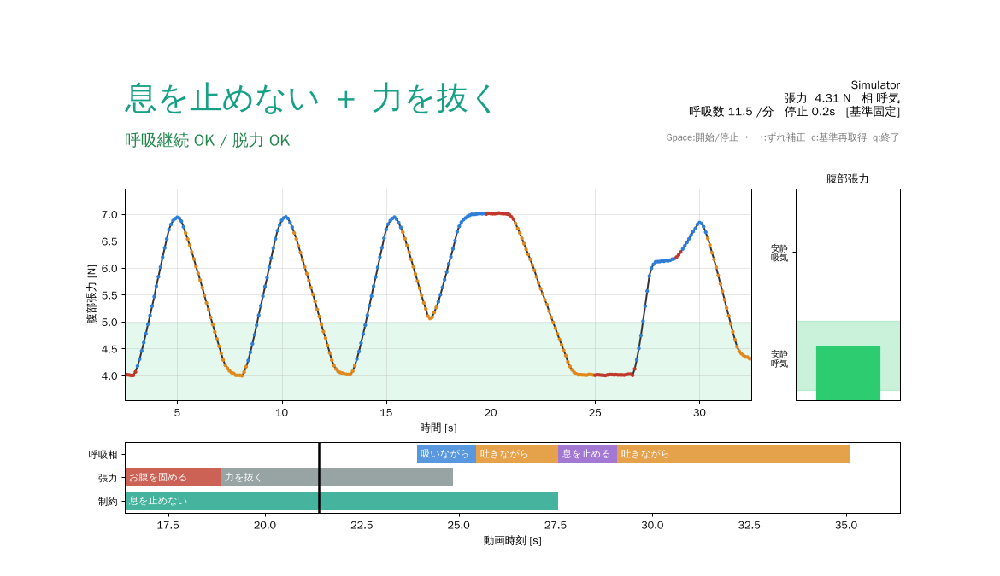

# GDX-RB Live Coach

Vernier Go Direct Respiration Belt（GDX-RB）の腹部張力をリアルタイム表示するツールです。
YouTube などの指導音声から「息を止めない」「吸いながら」「吐きながら」などを抽出し、
それに合わせて画面上でコーチングします。



## 構成
| ファイル | 役割 |
|---|---|
| `gdx_rb_live.py` | リアルタイムモニタとコーチング画面（実機またはシミュレータ） |
| `cue_extractor.py` | YouTube 字幕・Whisper・SRT/VTT からキューを抽出して JSON を出力 |
| `breath_core.py` | キーフレーズ辞書、張力の正規化、呼吸相の推定、適合判定 |
| `sample_lesson.srt` / `sample_cues.json` | 動作確認用のサンプル |

## 使い方
```bash
pip install -r requirements.txt

# 1) モニタのみ
python gdx_rb_live.py            # 実機（BLE/USB 自動）
python gdx_rb_live.py --sim      # センサーなし

# 2) 動画からキューを作る
python cue_extractor.py --url "https://www.youtube.com/watch?v=XXXX" -o cues.json
python cue_extractor.py --url "..." --whisper small -o cues.json   # 字幕が無い／自動字幕の精度が低い動画
python cue_extractor.py --subs lesson.srt -o cues.json

# 3) コーチング
python gdx_rb_live.py --cues cues.json
#   最初の 30 秒は安静呼吸で基準を取ります（右上が「基準固定」になるまで待つ）
#   → 動画の再生と同時に Space。ずれたら ← → で 0.5 秒ずつ補正
python gdx_rb_live.py --sim --cues sample_cues.json --calib 12 --autostart   # デモ
```
終了すると `session_YYYYmmdd_HHMMSS.csv`（全サンプル）と `_summary.json`（キューごとの適合率）を保存します。

## 計測とコーチングの仕組み

### 腹部張力の正規化
ベルト張力（N）は装着具合で大きく変わるため、直近の安静呼吸（既定 30 秒）の
10 / 90 パーセンタイルを基準にして **安静呼気 = 0、安静吸気 = 1** に正規化します。
基準は取得後に固定するので、「お腹を固める」で張力が上がっても基準は動きません（`c` で取り直せます）。

### 呼吸相の推定
平滑化した張力の傾き（0.6 秒窓の回帰）から推定します。
`> +0.12/s` は吸気、`< −0.12/s` は呼気です。どちらでもない状態が続くと「停止」と判定し、その継続秒数を数えます。
呼吸数は吸気が始まる間隔から計算します（実機ではデバイス側の Respiration Rate を優先）。

### キーフレーズ → キュー
| キュー | 主なフレーズ（正規表現） | チャネル | 目標・判定 |
|---|---|---|---|
| 息を止めない | 息を止めない／息は止めずに／呼吸を続け／don't hold your breath | 制約 | 停止が 2 秒を超えたら NG |
| 息を止める | 息を止めて／息をこらえ | 呼吸相 | 停止していれば OK |
| 吸いながら | 吸いながら／吸って／breathe in | 呼吸相 | 吸気中、または張力が 0.6 以上 |
| 吐きながら | 吐きながら／吐いて／breathe out | 呼吸相 | 呼気中、または張力が 0.4 以下 |
| お腹を固める | お腹に力／腹圧／お腹を固め／ブレーシング | 張力 | 張力が 0.6 以上を維持 |
| 力を抜く | 力を抜／リラックス／脱力 | 張力 | 張力が 0.35 以下 |

- 「息を止めない」は「息を止め」より先に判定するので、否定形を取り違えません。
- 字幕の 1 文に複数のフレーズがある場合（例:「吸って、吐いて」）は、文字の位置から時刻を補間します。Whisper を使う場合は単語のタイムスタンプを使います。
- キューの終了時刻は、同じチャネルの次のキューか、種類ごとの上限秒数の早い方です。「息を止めない」は「息を止めて」が来た時点で解除します。
- キュー提示から 0.8 秒は反応の猶予として判定しません。

### 画面
- 上段: 現在のキュー（大きな文字）と、判定メッセージ（緑は OK、赤は修正指示）
- 中段: 張力の波形（色は推定した呼吸相。赤は停止）と目標帯（緑の帯）
- 右: 腹部張力ゲージと目標帯
- 下段: キューのタイムライン（過去 5 秒から先 15 秒）

## 検討事項・今後の拡張
1. **動画との同期**: 今は Space キーで手動同期します。次の段階では、YouTube IFrame API を使うブラウザ版にして
   `getCurrentTime()` で自動同期するか、マイクで動画の音を拾い、文字起こしと照合して時刻を合わせる方法が考えられます。
2. **リアルタイム音声認識**: 事前抽出の代わりに、マイク入力を faster-whisper のストリーミングや Vosk で認識すれば、
   ライブ配信や対面の指導にも使えます（遅延は 1〜2 秒程度の見込み）。
3. **フレーズ辞書の拡充**: 「ドローイン（お腹をへこませる）」「鼻から／口から」「〇秒かけて」のような
   テンポの指示を取り込み、目標の傾き（張力 / 秒）を出せるようにします。
4. **LLM による意図分類**: 正規表現では拾えない言い回し（「呼吸は自然に」「お腹を薄く」など）は、
   字幕全体を Claude API に渡して `{t, kind, intensity}` の形で返してもらう方法が有効です（オフラインの前処理なので遅延は問題になりません）。
5. **判定の個人化**: 目標帯（0.6 など）は暫定値です。実測データで最大努力の吸気や腹圧のレベルを記録し、個人ごとに調整する必要があります。
6. **安全面**: 「息を止めない」の判定は、いきみ（バルサルバ）を避ける目的に向いています。
   高血圧などで息こらえを避けるべき人向けに、停止 NG のしきい値を厳しくするモードがあるとよいでしょう。
