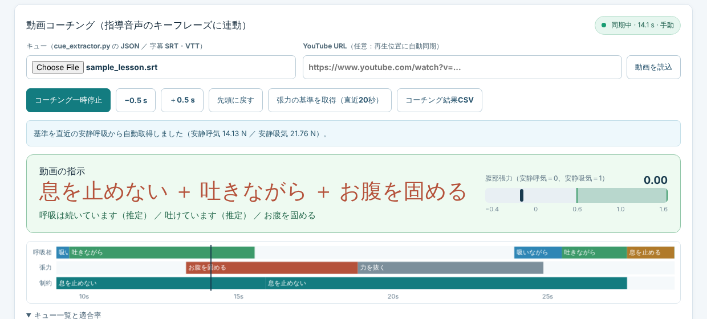

# GDX-RB Coach Live v1.2（ブラウザ版）

先生が作成した **GDX-RB Force Live Logger v1.1** に、指導動画のキーフレーズに合わせて
腹部張力を表示・判定する「動画コーチング」を追加したものです。



## ファイル
| パス | 内容 |
|---|---|
| `GDX_RB_Coach_Live.html` | **v1.2 本体**。Chrome で開きます（`build_html.py` が生成） |
| `v1_1/` | 先生の v1.1 配布物（**未改変**。`MANIFEST_SHA256.txt` と一致することをビルド時に確認） |
| `CoachCore.js` | キーフレーズ抽出と判定ロジック（依存なし、Node でテスト可能） |
| `coach_ui.js` | 動画コーチングの画面部分 |
| `build_html.py` | v1.1 の HTML と `app.js` から v1.2 を生成 |
| `tests/test_coach_core.cjs` | `CoachCore.js` のテスト（Python 版の抽出結果との一致も確認） |

```bash
python build_html.py              # GDX_RB_Coach_Live.html を再生成
node tests/test_coach_core.cjs    # テスト
```

## 使い方
1. いつもどおり「GDX-RBに接続して計測」（または「デモ計測」）を押します。
2. **10 秒以上、安静呼吸**をします。この区間を張力の基準（安静呼気 = 0、安静吸気 = 1）にします。
3. 「キュー」に指導動画の字幕（SRT / VTT）か、`gdx_rb_coach/cue_extractor.py` で作った `cues.json` を読み込みます。
4. 動画と同期します。
   - **自動**: YouTube の URL を入れて「動画を読込」を押し、埋め込みプレーヤーで再生します。再生位置に合わせて指示が進みます。
   - **手動**: 別のタブやアプリで動画を再生し、同時に「コーチング開始」を押します。ずれは ±0.5 s で補正します。
5. 「計測停止・CSV保存」を押すと、通常の CSV に `video_time_s`・`coach_cues`・`coach_ok` の列が追加されて保存されます。
   キューごとの適合率は「コーチング結果CSV」で保存できます。

> HTML をダブルクリックで直接開く（file://）と、YouTube の埋め込みが再生できない場合があります。
> 自動同期を使うときは `python -m http.server` を実行し、`http://localhost:8000/GDX_RB_Coach_Live.html` で開いてください（Web Bluetooth / WebHID も localhost で使えます）。

## 判定のしくみ
判定には v1.1 の `BreathClassifier`（張力の増減速度による呼吸状態の推定）を**そのまま**使います。

| 指示 | 主なフレーズ | 判定 |
|---|---|---|
| 息を止めない | 息を止めないで／息は止めずに／呼吸を続け | 呼吸状態が「呼吸停止の可能性」になったら注意（判定時間は v1.1 の設定に従う） |
| 息を止める | 息を止めて／息をこらえ | 「切替・静止中」または「呼吸停止の可能性」なら適合 |
| 吸いながら | 吸いながら／吸って | 「吸っています」、または張力が 0.6 以上なら適合 |
| 吐きながら | 吐きながら／吐いて | 「吐いています」、または張力が 0.4 以下なら適合 |
| お腹を固める | お腹に力／腹圧／お腹を固め | 張力が 0.6 以上なら適合（基準が必要） |
| 力を抜く | 力を抜／リラックス／脱力 | 張力が 0.35 以下なら適合（基準が必要） |

- 指示が出てから 0.8 秒は反応の猶予として判定しません。「切替・静止中」も吸気・呼気の判定対象から外します。
- 張力の基準は、コーチング開始時に直前 30 秒の平滑化張力の 10 / 90 パーセンタイルから自動で取得します。「張力の基準を取得」ボタンで直近 20 秒から取り直せます。吸気時の張力方向を切り替えると、基準はリセットされます。
- v1.1 の注意書きと同じく、判定はベルト張力にもとづく**目安**であり、呼吸の確定評価ではありません。

## v1.1 からの変更点
- 画面: 「動画コーチング」パネルを追加し、タイトルを v1.2 に変更しました。
- `app.js`: フックを 3 か所（サンプル受信、新しい試行、判定設定の変更）追加し、CSV に 3 列を追加しました。
  変更はすべて `build_html.py` の置換で行うため、`v1_1/app.js` 自体は書き換えていません。
- `BreathClassifier.js`: 変更なし。
